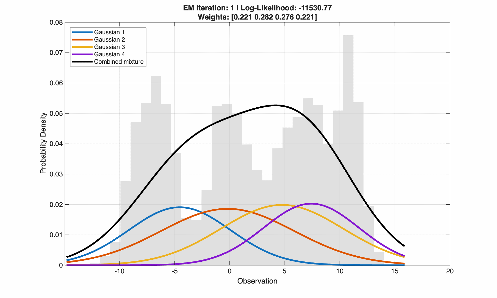

# Gaussian Mixture Models and Expectation Maximisation

**A MATLAB implmentation of the Expectation Maximisation algorithm to visualise how Gaussian Mixture Models describe heterogenous populations**


## Gaussian Mixture Models

Sometimes, the observed data of a probability distribution may have multiple peaks. A single Gaussian distribution may not be able to describe the data properly, so we design a Gaussian Mixture Model instead.

A **Gaussian Mixture Model** can be mathematically represented as a combination of multiple Gaussian distributions.
```math
p(x) = \sum_{k=1}^{K}\pi_k\cdot p(x|z=k,\theta_k)
```

where:

- $x$ = observed data point
- $K$ = number of Gaussian components
- $k$ = index of a particular component
- $\pi_k$ = weight of component $k$
- $z$ = hidden component label
- $\theta_k$ = parameters of component $k$ = $(\mu_k, \sigma^2_k)$
- $p(x|z=k,\theta_k)$ = probability density of observing $x$ under component $k$


## Expectation Maximisation
We use an iterative algorithm called **Expectation Maximisation** to adjust the GMM curves to fit the observed data. This works by alternating between two steps:

1. E-step: estimate the probability that each observation belongs to each Gaussian component
```math
r_{ik}=P(z_i=k|x_i,\:current\:parameters)
```
```math
r_{ik}=\frac{\pi_kN(x_i|\mu_k,\sigma^2_k)}{\sum_{j=1}^{K}\pi_jN(x_i|\mu_j,\sigma^2_j)}
```

2. M-step: update the Gaussian parameters using those probabilities
```math
\pi_k=\frac{1}{n}\sum_{i=1}^{n}r_{ik}
```
```math
\mu_k=\frac{\sum_{i=1}^{n}r_{ik}x_i}{\sum_{i=1}^{n}r_{ik}}
```
```math
\sigma^2_k=\frac{\sum_{i=1}^{n}r_{ik}(x_i-\mu_k)^2}{\sum_{i=1}^{n}r_{ik}}
```


## Visualisation


A GMM curve with 4 components fitting over a dataset with 4 populations using the EM algorithm.
